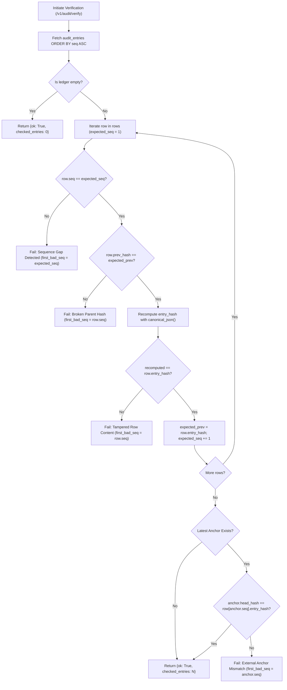

# BitGuard Audit Chain & External Object-Lock Anchoring Architecture (Milestone S21 / F18)

## 1. Executive Summary & Operating Invariants

BitGuard is a defensive signing firewall acting as a policy **DECISION point**. To provide non-repudiation and forensic resilience without storing private keys (Invariant #1), BitGuard maintains an **immutable, cryptographically verifiable hash-chained audit ledger** covering every policy decision, quarantine hold, WebAuthn approval, circuit breaker state evolution, and administrative configuration change.

This architecture **reduces and contains** unauthorized signing and audit tampering risks (**production-ready architecture; pilot after audit and shadow-mode validation**).

### Permanent Operating Invariants
1. **Invariant #3 (Fail-Closed Default):** Any detected sequence gap, broken hash pointer, corrupted entry payload, or external anchor mismatch marks the audit ledger as compromised and fails closed.
2. **Invariant #7 (Immutable Audit Trail):** Every event is appended to a strict monotonically increasing sequence chained via SHA-256. Database permissions permanently revoke `UPDATE` and `DELETE` operations.
3. **Invariant #8 (Explicit Data Provenance):** Every audit entry is tagged with its data provenance (`REAL`, `SYNTHETIC`, or `REPORTED`).
4. **Invariant #11 (Strict Wording):** "Reduces and contains", "production-ready architecture; pilot after audit and shadow-mode validation".

---

## 2. Cryptographic Hash Chain Specification

### 2.1 Canonical JSON Serialization (RFC 8785)
To prevent hash discrepancies caused by JSON formatting variations (such as key reordering, float representations, or whitespace differences), all audit entries are serialized into Canonical JSON prior to hashing:

```
canonical_json(data) = json.dumps(
    data,
    sort_keys=True,
    separators=(",", ":"),
    ensure_ascii=False,
    default=str
)
```

### 2.2 Entry Hash Derivation
Each block in the audit ledger commits to its immediate predecessor, forming a tamper-evident linear Merkle-like chain:

$$\text{entry\_hash}_i = \text{SHA-256}(\text{prev\_hash}_i \parallel \text{canonical\_json}(\text{entry}_i))$$

Where:
- $\text{prev\_hash}_1 = \text{"0"} \times 64$ (Genesis anchor consisting of 64 hexadecimal zeroes).
- For $i > 1$, $\text{prev\_hash}_i = \text{entry\_hash}_{i-1}$.
- $\text{entry}_i$ is the canonical dictionary:
  ```json
  {
    "action": "TRANSACTION_SIGNED",
    "actor": "spiffe://exchange.internal/workload/custody",
    "data_label": "REAL",
    "payload": {
      "chain": "ethereum",
      "decision_id": "req-98afbc71",
      "verdict": "ALLOW",
      "wallet": "0x1234567890123456789012345678901234567890"
    },
    "seq": 42,
    "ts": 1730678400.125
  }
  ```

---

## 3. Database Schema & Access Controls

### 3.1 Relational Schema (`audit_entries`)

| Column | Type | Constraints | Description |
| :--- | :--- | :--- | :--- |
| `seq` | `BIGINT` | `PRIMARY KEY, AUTOINCREMENT` | Strict 1-based monotonically increasing sequence number |
| `ts` | `DOUBLE PRECISION` | `NOT NULL` | Fractional Unix timestamp of event creation |
| `actor` | `VARCHAR(128)` | `NOT NULL` | Workload SAN, user ID, or system component |
| `action` | `VARCHAR(64)` | `NOT NULL, INDEX` | Event classification (e.g., `DECISION`, `BREAKER_ESCALATE`) |
| `payload` | `JSONB` / `JSON` | `NOT NULL` | Event-specific context, reasons, and parameters |
| `prev_hash` | `VARCHAR(128)` | `NOT NULL` | SHA-256 hash of previous block ($\text{entry\_hash}_{i-1}$) |
| `entry_hash`| `VARCHAR(128)` | `NOT NULL, UNIQUE` | SHA-256 hash over $\text{prev\_hash} \parallel \text{canonical\_json}(\text{entry})$ |
| `data_label`| `VARCHAR(16)` | `NOT NULL` | `REAL`, `SYNTHETIC`, or `REPORTED` |

### 3.2 SQL Level Immutability Enforcement
The application service role is strictly append-only:

```sql
-- Revoke row-level mutability for application roles
REVOKE UPDATE, DELETE, TRUNCATE ON audit_entries FROM bitguard_app;
REVOKE UPDATE, DELETE, TRUNCATE ON audit_anchors FROM bitguard_app;
GRANT SELECT, INSERT ON audit_entries TO bitguard_app;
GRANT SELECT, INSERT ON audit_anchors TO bitguard_app;
```

---

## 4. External Object-Lock Anchoring (WORM Storage)

To protect against privileged attackers or database administrators who might rewrite database rows and recalculate subsequent hashes, BitGuard periodically publishes the chain state to an external Write-Once-Read-Many (WORM) storage bucket:

### 4.1 Anchoring Checkpoint Payload
An anchor checkpoint commits the state at sequence $N$:
```json
{
  "head_hash": "e3b0c44298fc1c149afbf4c8996fb92427ae41e4649b934ca495991b7852b855",
  "seq": 1420,
  "ts": 1730678460.0
}
```

### 4.2 MinIO / S3 Object-Lock Integration
In `docker-compose.yml`, MinIO is deployed with Object Lock support enabled (`mc mb --with-lock`).
Anchors are written with governance retention headers:
- `x-amz-object-lock-mode: GOVERNANCE` (or `COMPLIANCE` in regulated production).
- `x-amz-object-lock-retain-until-date: <ISO8601 Timestamp + 365 days>`.
- Object Key: `anchors/anchor_{seq:012d}_{timestamp}.json`.

### 4.3 Scheduling
- **Production Schedule:** Configured daily (`audit_anchor_interval_seconds=86400`).
- **Lab & Testing Schedule:** Configured at 1-minute intervals (`audit_anchor_interval_seconds=60`).
- **On-Demand:** Authorized SecOps/Admin/Compliance roles can trigger an immediate anchor via `POST /v1/audit/anchor`.

---

## 5. Chain Verification Algorithm (`GET /v1/audit/verify`)

The verification engine inspects the entire chain from Genesis to Head:



### Forensic Pinpointing Guarantee
1. **Row Content Modification:** If any row's actor, action, timestamp, or payload is modified directly in the database, `verify_chain` identifies the exact sequence number `first_bad_seq = row.seq`.
2. **Row Deletion:** If any row is deleted from the middle of the table, `row.seq != expected_seq` immediately trips and flags the missing sequence `first_bad_seq = expected_seq`.
3. **Tail Row Deletion:** If rows at the tail of the table are deleted after an anchor has been written, the check `anchor.seq > len(rows)` detects the truncation.
4. **Historical Rewrite:** If an attacker modifies an old row and recomputes all subsequent hashes, the check against the immutable external object-lock anchor detects the divergence.

---

## 6. SIEM Export Integration

Audit events are simultaneously exported to enterprise SIEM and security monitoring platforms:

### 6.1 RFC 5424 Syslog
When `audit_siem_enabled=True` and `audit_siem_format="syslog"`:
- Transmitted over UDP/TCP to corporate log aggregators (Splunk, Elastic, Datadog).
- Structured Header includes `seq`, `action`, `actor`, and `entry_hash`.
- Message body contains the canonical JSON event payload.

### 6.2 OpenTelemetry (OTLP) Logs
When `audit_siem_format="otel"`:
- Formatted as OpenTelemetry `LogRecord` protocol buffers / JSON.
- Dispatched via HTTP POST to the OpenTelemetry Collector at `audit_siem_otel_endpoint`.

---

## 7. API Reference

| Method | Endpoint | Required Role / Permission | Purpose |
| :--- | :--- | :--- | :--- |
| `GET` | `/v1/audit/verify` | `READ_AUDIT` (`Viewer`+) | Recomputes full chain, checks anchors, returns `{ok, checked_entries, first_bad_seq, last_anchor}` |
| `GET` | `/v1/audit/entries` | `READ_AUDIT` (`Viewer`+) | Paginated list of audit records with cursor and action filtering |
| `POST` | `/v1/audit/anchor` | `SecOps`, `Compliance`, `Admin` | Forces immediate object-lock anchor write of current head |
