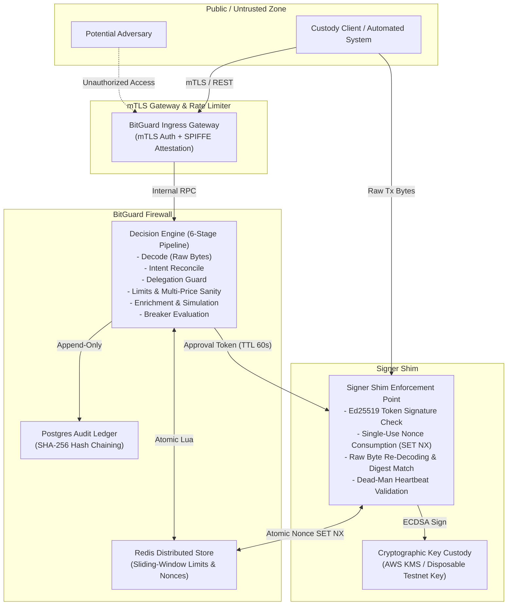

# BitGuard External Penetration Test & Security Assessment Brief

> [!IMPORTANT]
> **Safety & Environment Boundary (Invariant #9):**
> Testing is restricted exclusively to **local chains (Foundry Anvil)** and **public testnets (e.g. Sepolia)** using disposable test keys.
> **No mainnet access, no real assets, no real funds.**
> Attack vectors must be structured data payloads and simulation patterns, not exploit tooling or destructive malware.
> Claim standard (Invariant #11): BitGuard reduces and contains unauthorized transaction signing; production-ready architecture; pilot after audit and shadow-mode validation; target p99 under 15 ms, measured.

---

## 1. Engagement Overview & Scope

### In-Scope Assets

| Target Component | Service Description | Interfaces & Ports |
| :--- | :--- | :--- |
| **BitGuard Decision Point** | Autonomous policy firewall evaluating withdrawal requests against limits, delegations, and intents | HTTP REST (`/v1/*`), WebSocket (`/v1/stream`), Port 8000 |
| **Signer Shim (Enforcement Point)** | Cryptographic signing service isolated from policy logic; enforces approval tokens and nonce single-use | HTTP REST (`/sign`, `/heartbeat`, `/healthz`), Port 8001 |
| **Circuit Breaker Subsystem** | Dynamic containment engine with instant lockdown and dual-control de-escalation | `/v1/breaker/*`, Redis distributed state |
| **Audit Ledger Engine** | Cryptographically chained, tamper-evident SHA-256 audit log with object-lock verification | `/v1/audit/*`, PostgreSQL / SQLite storage |
| **Incident & Quorum Controls** | Multi-approver HOLD ticket resolution and WebAuthn hardware-bound approvals | `/v1/holds/*`, `/v1/approvals/*` |

### Out-of-Scope Assets
- Public mainnet blockchain nodes, validators, and miners.
- Third-party SaaS infrastructure (AWS global control plane, Cloudflare, Alchemy/Infura public nodes).
- Physical infrastructure, physical office access, and social engineering against non-testing personnel.

---

## 2. Architecture & Trust Boundaries

### Trust Boundary Analysis
1. **Perimeter Boundary (Untrusted -> Gateway):** Validates caller identity, client certificate mTLS SAN attributes, and image build attestations. Rejects unauthenticated callers.
2. **Decision-to-Enforcement Boundary (BitGuard -> Signer Shim):** BitGuard never holds signing keys (Invariant #1). The Signer Shim acts as a zero-trust gate that treats BitGuard as an external token issuer whose tokens must be cryptographically verified against a configured public key set.
3. **Data Plane Boundary (Shim -> State Store):** Nonces are atomically consumed via Redis `SET ... NX`. If Redis is offline, the system fails closed (Invariant #3).
4. **Key Boundary (Shim -> KMS / HSM):** Private keys are locked in HSM hardware. Key policies forbid human principals from invoking `kms:Sign`.

---

## 3. Test Accounts & Pre-Provisioned Credentials

The following synthetic credentials and roles are provisioned in the testnet integration environment:

| User Identifier | Role | WebAuthn Credential ID | Authorized Actions |
| :--- | :--- | :--- | :--- |
| `admin-user-01` | `Admin` | `cred-admin-01-fido2` | Policy evolution, configuration, audit inspection |
| `secops-user-01` | `SecOps` | `cred-secops-01-fido2` | Instant breaker lockdown, watched address rules |
| `approver-user-01` | `Approver` | `cred-approv-01-fido2` | Dual-control quorum HOLD approval, breaker unlock |
| `approver-user-02` | `Approver` | `cred-approv-02-fido2` | Dual-control quorum second approver |
| `operator-user-01` | `Operator` | N/A | Submit signing requests, view dashboards |
| `compliance-01` | `Compliance` | N/A | Read audit logs, export SOC 2/ISO reports |
| `viewer-user-01` | `Viewer` | N/A | Read-only metrics and status inspection |

- **Disposable Hot Wallet Address:** `0x742d35Cc6634C0532925a3b844Bc454e4438f44e`
- **Disposable Private Key (Testnet Only):** `0x4f3edf983ac636a65a842ce7c78d9aa706d3b113bce9c46f30d7d21715b23b1d`
- **Chain ID:** `31337` (Anvil Local) / `11155111` (Sepolia)

---

## 4. Rules of Engagement

1. **Non-Mainnet Verification:** Assessors must confirm that all signing targets connect to local Anvil test instances or public testnets. Any attempt to supply mainnet RPC endpoints or live exchange API credentials is strictly prohibited and immediately terminates the assessment.
2. **Fail-Closed Verification:** Testers are explicitly encouraged to simulate upstream and downstream outages (e.g. killing Redis, injecting network packet loss, simulating dead-man heartbeat expiration) to verify that the firewall fails closed under stress.
3. **Exploit Tooling Policy:** Tests must be conducted using programmatic REST clients, Python scripts, or provided testnet harnesses. Weaponized exploit payloads designed to achieve arbitrary remote code execution on the host OS are prohibited.
4. **Data Integrity:** Assessors may not attempt to delete production backups or modify external object-lock storage buckets.

---

## 5. Success Criteria for Security Assessment

A finding is graded **CRITICAL** if the assessor successfully demonstrates any of the following:

| Finding ID | Objective & Breach Condition | Expected Defensive Response |
| :--- | :--- | :--- |
| **CRIT-01** | **Unauthenticated Signing:** Inducing the Signer Shim to sign raw transaction bytes without supplying a valid, unexpired BitGuard approval token. | Request refused with HTTP 400 (`MISSING_APPROVAL_TOKEN` or `INVALID_APPROVAL_TOKEN`). |
| **CRIT-02** | **Approval Replay:** Submitting an approval token that has already been consumed to sign a second transaction. | Request refused with HTTP 400 (`NONCE_ALREADY_CONSUMED`). |
| **CRIT-03** | **Digest Tampering:** Modifying transaction recipient or amount in raw bytes while reusing an approval token issued for a different transaction. | Request refused with HTTP 400 (`RECOMPUTED_DIGEST_MISMATCH`). |
| **CRIT-04** | **Outage Fail-Open:** Inducing BitGuard or Signer Shim to approve/sign a transaction while Redis, PostgreSQL, or RPC nodes are offline. | System fails closed: decision returns `DENY` (`LIMIT_STORE_UNAVAILABLE`); shim returns `REFUSED`. |
| **CRIT-05** | **Single-Person Policy Loosening:** Submitting and activating a policy that raises caps or removes restrictions without dual-control quorum or cooldown. | API returns HTTP 400/403 requiring multi-approver quorum and backtest verification. |
| **CRIT-06** | **Silent Audit Ledger Alteration:** Directly modifying or deleting rows in the database without being detected by `GET /v1/audit/verify`. | Audit verification flags `ok=False` and pinpoints the exact sequence number `first_bad_seq`. |
| **CRIT-07** | **Key Material Disclosure:** Extracting private signing keys from the BitGuard decision point container or memory dump. | Impossible by design: BitGuard decision point does not hold or store signing keys. |
