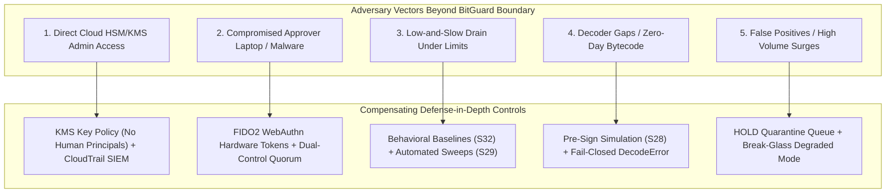

# BitGuard System Limitations, Attack Boundaries & Compensating Controls

> [!IMPORTANT]
> **Defensive Scope & Language Standards (Invariant #11):**
> BitGuard is a defense-in-depth policy firewall that **reduces and contains** unauthorized transaction signing risks for exchange hot wallets. It does not provide absolute prevention against all imaginable threat vectors.
> Architecture classification: **production-ready architecture; pilot after audit and shadow-mode validation**.
> Latency benchmark: **target p99 under 15 ms for the local fast path, measured under load** (measured pipeline p99: 2.398 ms at 50 concurrency, 2.814 ms at 200 concurrency, and 2.633 ms at 500 concurrency per [docs/PERF.md](PERF.md)).

---

## 1. What BitGuard Cannot Do & Compensating Controls

Every defensive system operates within explicit architectural boundaries. The table below catalogs the threat boundaries where BitGuard alone cannot prevent compromise, paired with the mandatory compensating controls deployed to contain the blast radius.

---

### Limitation 1: Direct Cloud HSM / KMS Root Access

- **The Limitation:** If an attacker gains AWS root administrative credentials or physical access to the HSM hardware, they can issue signatures directly against AWS KMS or a Luna HSM, bypassing the BitGuard network path entirely. BitGuard is an application-level decision point and cannot defend against direct physical or hypervisor compromise of external cryptographic modules.
- **Compensating Controls:**
  - **Zero Human Principals Key Policy:** AWS KMS key policies explicitly deny `kms:Sign` to all IAM users and federated human roles. Only the Signer Shim execution role (`BitGuardSignerShimRole`) can sign, restricted by VPC endpoint conditions (`aws:sourceVpc`).
  - **Account Isolation:** Cryptographic keys reside in a dedicated, isolated AWS Security/Custody account distinct from application workloads and CI/CD runners.
  - **CloudTrail SIEM Telemetry:** CloudTrail streams real-time data events to an immutable SIEM; any `kms:Sign` request originating outside the Signer Shim IP/VPC trips automated Sev-1 alarms.

---

### Limitation 2: Compromised Operator & Approver Laptops

- **The Limitation:** BitGuard cannot guarantee the endpoint security of human operator laptops. An attacker with rootkit/malware on an engineer's laptop could attempt to extract session cookies, forge API requests, or hijack browser sessions.
- **Compensating Controls:**
  - **FIDO2 / WebAuthn Hardware Presence (Invariant #5):** Approvals for quarantined transactions (HOLD releases) and breaker de-escalations require physical hardware token interaction (YubiKey user presence / biometric gesture). Session tokens or browser cookies alone cannot authorize a release.
  - **Dual-Control Quorum:** Releases require $n$-of-$m$ (minimum 2) independent human approvals from distinct approver identities on physically separate devices.
  - **Separation of Duties:** The original transaction requester is programmatically blocked from approving their own request.
  - **Withdrawal Time-Locks (S30):** High-value withdrawals enter a mandatory cooldown window (`PENDING_RELEASE`), allowing SecOps to cancel unauthorized releases before funds leave.

---

### Limitation 3: Attackers Staying Under Every Limit ("Low-and-Slow" Drain)

- **The Limitation:** An attacker with legitimate access or stolen credentials might attempt a slow drip attack, issuing hundreds of small transactions over weeks that individually stay below single-transaction thresholds and velocity caps.
- **Compensating Controls:**
  - **Rolling Behavioral Baselines (S32 / F15):** Per-wallet 28-day statistical baselines track volume distributions by hour of day ($p50, p95, p99$), distinct new destination bursts, and transfer size outliers. Abnormal velocity or off-hours spikes accumulate risk weight and trigger quarantine.
  - **Exposure Reduction & Automated Sweeps (S29 / F11):** Hot wallets maintain strict balance ceilings (`max_hot_balance`). Automated sweep proposals continuously drain excess liquidity to cold storage, leaving only minimal operational float in the hot tier.
  - **Multi-Scope Velocity Accumulation:** Outflows are metered simultaneously across per-wallet, per-asset, per-chain, and global sliding windows.

---

### Limitation 4: Decoder Gaps & Obfuscated Contract Bytecode

- **The Limitation:** Novel DeFi protocols, unverified smart contracts, or self-modifying proxy patterns may exhibit behavior not apparent from static calldata analysis.
- **Compensating Controls:**
  - **Fail-Closed Default (Invariants #3 & #4):** Any unrecognized ABI encoding, malformed RLP/PSBT structure, or decoding failure immediately raises `DecodeError` and is DENIED.
  - **Pre-Sign Simulation on Anvil Fork (S28 / F5):** Transactions are executed against a live fork of state before signing. If observed state balance deltas differ from the explicit intent (`SIM_BALANCE_MISMATCH`), the transaction is placed on HOLD.
  - **Sanctions & Contract Profiler (S27):** Contract bytecode hashes and destination addresses are checked against local OFAC sanctions lists and dangerous delegate registries before evaluation.

---

### Limitation 5: False Positives & Operational Friction

- **The Limitation:** A deterministic, fail-closed firewall will inevitably quarantine legitimate transactions during unprecedented market volatility, flash crashes, or sudden customer withdrawal surges.
- **Compensating Controls:**
  - **Quarantine HOLD Rather Than Outright Drop:** Unclassified or borderline transactions are placed in a quarantined HOLD state rather than permanently denied, preserving customer transaction sequence.
  - **Emergency Break-Glass Degraded Mode:** In emergency scenarios (e.g. state store failure during incident recovery), a two-approver quorum can activate a time-bounded degraded mode allowing whitelisted emergency rescue destinations.
  - **Shadow-Mode Pilot Validation (S26):** BitGuard is validated in shadow mode against recorded historical traffic before active policy enforcement.

---

## 2. Technical Reference: Limit Store & Sliding Window Key Schema

BitGuard enforces outflow velocity limits using an atomic, distributed sliding-window limit store (`LimitStore`). All amounts are represented strictly as **integers in smallest units** (e.g., satoshis, wei).

### Redis Key Schema

| Key Pattern | Type | Description | Score Format | Member Format |
| :--- | :--- | :--- | :--- | :--- |
| `limit:scope:wallet:{wallet}:{window_s}:c` | `ZSET` | Committed outflow transactions for a wallet | Timestamp (epoch seconds) | `{amount}:{reservation_id}` |
| `limit:scope:wallet:{wallet}:{window_s}:r` | `ZSET` | Active reservations for a wallet | Expiration timestamp (`now + ttl`) | `{amount}:{reservation_id}` |
| `limit:scope:asset:{asset}:{window_s}:c` | `ZSET` | Committed volume for an asset (e.g. `USDC`, `ETH`) | Timestamp (epoch seconds) | `{amount}:{reservation_id}` |
| `limit:scope:asset:{asset}:{window_s}:r` | `ZSET` | Active reservations for an asset | Expiration timestamp (`now + ttl`) | `{amount}:{reservation_id}` |
| `limit:scope:chain:{chain}:{window_s}:c` | `ZSET` | Committed volume for a blockchain network | Timestamp (epoch seconds) | `{amount}:{reservation_id}` |
| `limit:scope:chain:{chain}:{window_s}:r` | `ZSET` | Active reservations for a blockchain network | Expiration timestamp (`now + ttl`) | `{amount}:{reservation_id}` |
| `limit:scope:global:{window_s}:c` | `ZSET` | Committed global firewall outflow volume | Timestamp (epoch seconds) | `{amount}:{reservation_id}` |
| `limit:scope:global:{window_s}:r` | `ZSET` | Active global firewall outflow reservations | Expiration timestamp (`now + ttl`) | `{amount}:{reservation_id}` |
| `limit:res:{reservation_id}` | `HSET` | Reservation state metadata | N/A | Fields: `amount`, `status`, `scopes` |

### Atomic Lua Operations
- **`reserve`:** Atomically evaluates used budget against cap across all scopes. Adds reservation member to `$K:r`.
- **`commit`:** Moves reservation from `$K:r` to `$K:c` upon successful broadcast.
- **`release`:** Removes reservation from `$K:r` if transaction is cancelled or denied.
- **Fail-Closed Fallback:** If Redis is unreachable, BitGuard switches to conservative `LocalFallbackStore` caps or rejects with `LIMIT_STORE_UNAVAILABLE`.
