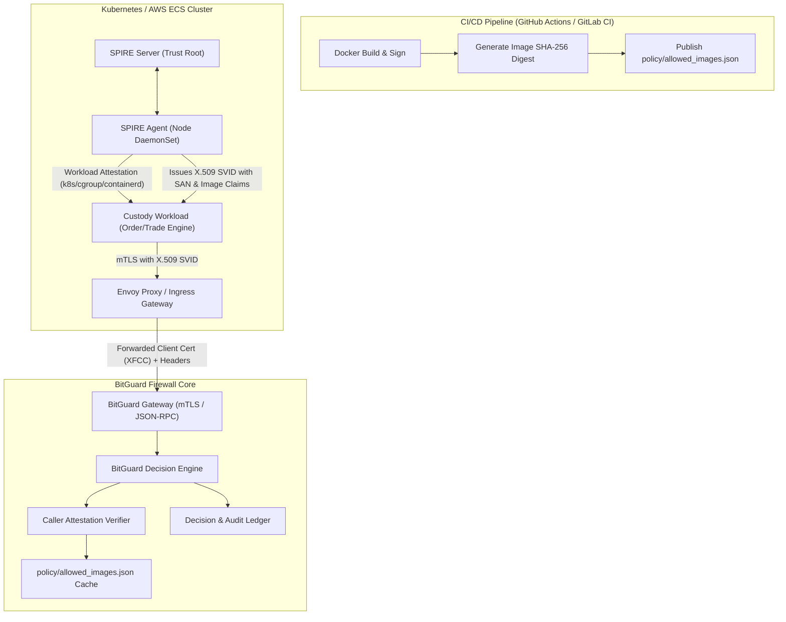

# Production Workload Identity and Attestation with SPIFFE/SPIRE (F16)

## Overview

In enterprise transaction signing environments, validating transaction payload bytes alone is necessary but insufficient. Attackers compromising a node or cluster might deploy modified containers, inject rogue execution binaries, or attempt lateral RPC injection from untrusted internal subnets.

**BitGuard** integrates cryptographic **caller identity and build attestation** (Milestone S33 / Feature F16). This architecture **reduces and contains** unauthorized signing exposure (a limit-aware attacker can still move value; the goal is to shrink and slow loss and force detection) by binding each incoming signing request to:
1. **Authenticated Workload Identity (mTLS SAN / SPIFFE ID)**: Cryptographically verified X.509 SVID issued by a trusted SPIRE server.
2. **Attested Container Image Digest (`image_digest`)**: Immutable SHA-256 digest of the running container image, verified against CI-published manifests.
3. **Deployment Freshness Window (`deploy_time`)**: Time-since-deployment evaluation to flag newly deployed callers undergoing early runtime scrutiny.
4. **Source Network Boundary (`source_ip`)**: Network CIDR allowlists ensuring calls originate only from authorized VPC service meshes.

> [!IMPORTANT]
> **Production Readiness Statement:** This design represents a production-ready architecture; pilot after audit and shadow-mode validation. Local fast-path local policy decision has a **target p99 under 15 ms for the local fast path, measured under load** (measured pipeline p99: 2.398 ms at 50 concurrency, 2.814 ms at 200 concurrency, and 2.633 ms at 500 concurrency per [docs/PERF.md](PERF.md)). System boundaries detailed in [docs/LIMITS.md](LIMITS.md).

---

## Architecture



---

## SPIFFE / SPIRE Workload Attestation Flow

In production, workloads obtain their credentials through the **SPIFFE Workload API** served over a local UNIX domain socket by the **SPIRE Agent**:

1. **Workload Discovery & Attestation:**
   When the custody workload requests an SVID, the SPIRE Agent interrogates the host operating system kernel and container runtime:
   - Linux Cgroup path and namespaces.
   - Container runtime (containerd/CRI-O/Docker) container ID and image digest (`sha256:...`).
   - Kubernetes namespace, ServiceAccount, and Pod UID.
2. **SVID Issuance:**
   The SPIRE Agent constructs an X.509 certificate containing:
   - **Subject Alternative Name (SAN):** `spiffe://exchange.internal/ns/custody/sa/trade-executor`
   - **Attestation Claims (URI Query or Custom Extensions):**
     - Image Digest: `sha256:4b227777d4dd1fc61c6f884f48641d02b4d121d3fd328cb08b5531fcacdabf8a`
     - Deploy Time: `2026-11-11T10:00:00Z`
3. **mTLS Handshake:**
   The client presents this SVID during mTLS termination at the BitGuard gateway or upstream Envoy sidecar.

---

## Policy Checks and Reason Codes

BitGuard evaluates caller attestation within **Stage 5 (Enrichment)** and enforces verdicts in **Stage 6 (Decide)**:

| Engine Reason Code | Verdict / Weight | Condition | Remediation / Rationale |
| :--- | :--- | :--- | :--- |
| `CALLER_UNKNOWN_DIGEST` | **HOLD** (Quarantine) | Container image digest does not match any entry in `policy/allowed_images.json`. | An unapproved binary or tampered image attempted signing. Requires multi-party WebAuthn quorum to release or investigate. |
| `CALLER_RECENT_DEPLOY` | **Risk Weight** (default +25) | Caller was deployed within the freshness window (default: 3600 seconds). | Newly released workloads undergo higher risk scrutiny during initial canary/burn-in period. |
| `CALLER_UNUSUAL_SOURCE` | **Risk Weight** (default +40) | Caller source IP address falls outside configured VPC/cluster CIDR allowlist. | Detects unauthorized cross-zone or misrouted signing calls. |
| `INVALID_CALLER_IDENTITY` | **DENY** (Hard Deny) | Missing, expired, untrusted CA signature, or unapproved SAN. | Invariant #3 Fail-Closed enforcement. |

---

## CI/CD Publishing Pipeline

The authorized image catalog is maintained cryptographically in `policy/allowed_images.json`:

```json
{
  "version": "1.0.0",
  "updated_at": "2026-11-11T12:00:00Z",
  "allowed_images": [
    {
      "image": "bitguard/trade-executor",
      "tag": "v1.0.0",
      "digest": "sha256:4b227777d4dd1fc61c6f884f48641d02b4d121d3fd328cb08b5531fcacdabf8a",
      "built_at": "2026-11-11T10:00:00Z"
    }
  ],
  "allowed_digests": [
    "sha256:4b227777d4dd1fc61c6f884f48641d02b4d121d3fd328cb08b5531fcacdabf8a"
  ]
}
```

In `.github/workflows/ci.yml`, every build stage commits the exact sha256 digest:
```bash
python scripts/publish_image_digest.py \
  --image "bitguard/custody-workload" \
  --tag "${{ github.sha }}" \
  --digest "${{ steps.build.outputs.digest }}" \
  --output "policy/allowed_images.json"
```

---

## Asymmetric Policy Evolution (Invariant #6)

Changes to caller attestation policies adhere strictly to asymmetric governance:
- **Tightening (Instant):** Adding new image digest constraints, shrinking the recent-deploy window, or restricting source networks takes effect immediately with a single authorized SecOps signature.
- **Loosening (Quorum + Cool-down + Backtest):** Expanding allowed CIDRs, relaxing digest requirements, or increasing freshness windows requires dual-control WebAuthn quorum, an attached backtest report, and mandatory cool-down period.

---

## Audit Trail Persistence (Invariant #7)

Every decision evaluated by BitGuard records caller attestation attributes directly into the hash-chained audit log and database:
- `caller_identity`: Workload SAN or SPIFFE ID.
- `caller_image_digest`: Exact container image digest.
- `caller_deploy_time`: Workload deployment timestamp.
- `caller_source_ip`: Verified source network address.

This provides forensic traceability for every signed transaction and quarantined HOLD.
