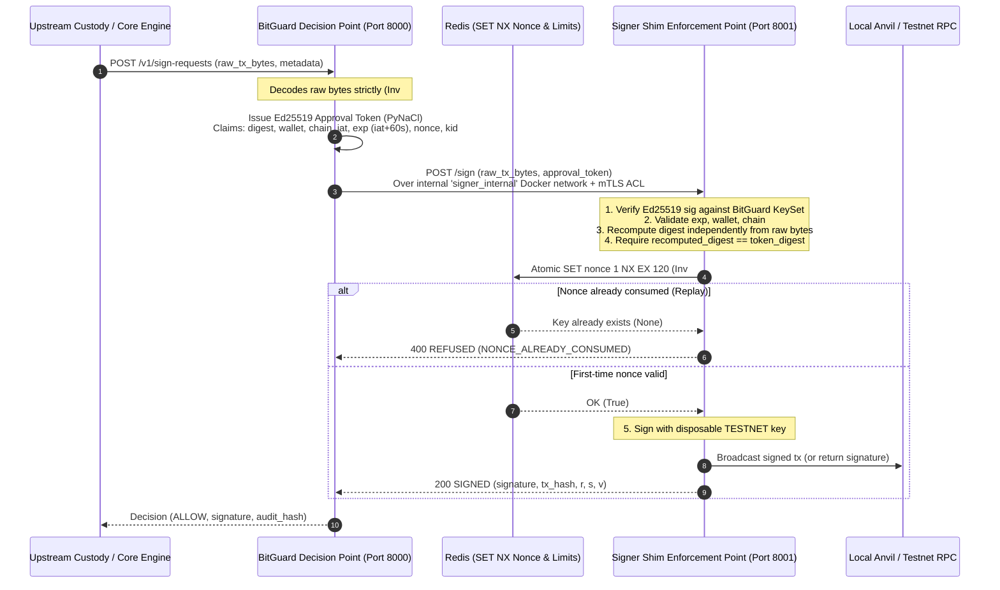

# BitGuard Approval Token & Signer Shim Threat Model (Milestone S11 / F1)

## Executive Summary

BitGuard operates strictly as a policy **DECISION point**. The isolated **Signer Shim** operates as the **ENFORCEMENT point**. Under Invariant #1 (*Key Isolation*), BitGuard never stores, manages, or handles transaction signing private keys. The signer shim alone holds disposable testnet keys in an isolated enclave.

The cryptographic hand-off between BitGuard and the Signer Shim reduces and contains hot-wallet signing risk by binding decisions to immutable transaction payload digests via asymmetric Ed25519 approval tokens.

> [!IMPORTANT]
> **Production-Ready Architecture:** This system represents a production-ready architecture; pilot after audit and shadow-mode validation. All keys utilized in lab and test environments are strictly disposable testnet keys (Invariant #9).

---

## Architecture & Cryptographic Workflow



---

## Token Specification (PyNaCl Ed25519)

Approval tokens are compact URL-safe Base64 strings formatted as standard JWS structures:

$$\text{Token} = \text{base64url}(\text{Header}) \,.\, \text{base64url}(\text{Claims}) \,.\, \text{base64url}(\text{Signature})$$

### 1. JWS Header
```json
{
  "alg": "EdDSA",
  "typ": "JWT",
  "kid": "bg-ed25519-v1"
}
```

### 2. Claims Payload
```json
{
  "digest": "0x3b890885c07ee9... (keccak256 of raw unsigned tx)",
  "wallet": "0x742d35cc6634c0532925a3b844bc454e4438f44e",
  "chain": "ethereum",
  "iat": 1730660000,
  "exp": 1730660060,
  "nonce": "a1b2c3d4e5f60718293a4b5c6d7e8f90",
  "kid": "bg-ed25519-v1"
}
```

### 3. Key Management & Key Rotation
- **Key Isolation:** The BitGuard Ed25519 private key is held strictly by BitGuard and never shared with the shim or custody systems.
- **Key Rotation Support:** The `KeySet` maintains multiple keys indexed by `kid`. Keys transition from `ACTIVE` to `RETIRED`. When a key is retired, the signer shim rejects new tokens signed by that key (`RETIRED_KID`), while allowing older signatures to be validated during transition cooldowns.

---

## Six Invariant Enforcement Steps in Signer Shim

Upon receiving `POST /sign` with `{raw_tx_bytes, token}`, the signer shim executes the following sequential pipeline:

1. **Verify Token Signature:** Cryptographically validates the Ed25519 signature over `header.claims` against the configured BitGuard `KeySet`. Rejects invalid signatures (`INVALID_TOKEN_SIGNATURE`), unknown keys (`UNKNOWN_KID`), or retired keys (`RETIRED_KID`).
2. **Check Expiration, Wallet, and Chain:** Checks that `current_time <= claims.exp` (60-second validity window; rejects with `TOKEN_EXPIRED`). Verifies that the target wallet and chain match the token claims.
3. **Independent Digest Recomputation:** Invariant #4 (*Raw Byte Source of Truth*): The shim re-decodes `raw_tx_bytes` using `evm_decoder` and recomputes the signing digest. It requires:
   $$\text{recomputed\_digest} \equiv \text{token.digest}$$
   If a malicious caller modified the raw bytes, or if BitGuard's pipeline was tampered with in flight, the digests diverge and the shim returns `DIGEST_MISMATCH`.
4. **Atomic Nonce Consumption:** To eliminate replay attacks, the 128-bit random nonce is committed to Redis using an atomic `SET NX` command:
   $$\text{SET} \quad \text{nonce:}\langle\text{nonce}\rangle \quad \text{"1"} \quad \text{EX} \quad 120 \quad \text{NX}$$
   If the key already exists, Redis returns `None` and the request is immediately refused with `NONCE_ALREADY_CONSUMED`. If Redis is unavailable, the shim fails closed with `NONCE_STORE_UNAVAILABLE` (Invariant #3).
5. **Disposable Key Signing:** Only after all 4 verification gates pass does the shim sign the digest using its disposable testnet private key (`Account._sign_hash`), generating `r`, `s`, and `v`.
6. **Immutable Logging:** Every signature and refusal is recorded with structured telemetry (`signing_approved` or `signing_refusal` with failure code and diagnostics).

---

## Network Isolation & Threat Model Analysis

### Network Boundary Topology
- **`public` Network:** Exposes BitGuard (Port 8000), Anvil (Port 8545), Postgres, and Redis.
- **`signer_internal` Network:** Marked `internal: true` in Docker Compose. No external Internet gateway and no published host ports.
- **Signer Shim Port Exposure:** Port 8001 is declared with `expose: ["8001"]` and **never** `ports: ["8001:8001"]`. It is completely unreachable from outside the Docker daemon or from containers attached only to the `public` network.
- **Internal ACL:** BitGuard presents an internal shared-secret token (`X-BitGuard-Internal-Auth`) on every invocation. Direct invocations lacking this credential are systematically blocked with `403 Forbidden` (`UNAUTHORIZED_INTERNAL_CALLER`).

### Threat Vectors & Mitigations

| Threat Vector | Attack Scenario | Defense & Mitigation | Invariant Enforced |
| :--- | :--- | :--- | :--- |
| **BitGuard Compromised** | Attacker compromises BitGuard container and attempts arbitrary signing. | BitGuard holds **no** signing keys. Attacker can only issue approval tokens, but the shim independently recomputes transaction digests and rejects tokens for unapproved destinations or amounts. Fast 60s TTL limits token window. | Invariant #1 (*Key Isolation*), Invariant #2 (*Approval Binding*) |
| **Signer Shim Compromised** | Attacker gains control of signer shim. | Shim only contains a disposable testnet key (Invariant #9). No mainnet funds or private keys exist anywhere in the environment. | Invariant #1, Invariant #9 (*Safety Boundary*) |
| **Token Replay / Duplication** | Attacker captures a valid approval token and attempts to execute the transaction twice. | The 128-bit nonce is atomically consumed in Redis via `SET NX` on first execution. Subsequent attempts are rejected with `NONCE_ALREADY_CONSUMED`. | Invariant #2 (*Approval Binding*) |
| **Payload Tampering in Flight** | Attacker intercepts approval token and swaps destination or amount in `raw_tx_bytes`. | The shim recomputes keccak256 digest from `raw_tx_bytes` itself. Tampering breaks $\text{recomputed\_digest} == \text{token\_digest}$, triggering immediate `DIGEST_MISMATCH` refusal. | Invariant #2, Invariant #4 (*Raw Byte Source of Truth*) |
| **Bypass Attempt from Custody Engine** | Malicious or compromised upstream custody service attempts to call signer shim directly without passing through BitGuard. | 1. Network route blocked: `signer_shim` is unreachable from `public` network (`internal: true`).<br/>2. ACL gate: Direct call lacks internal authorization header, rejected with `403 Forbidden`. | Invariant #1, Invariant #3 (*Fail Closed*) |
| **Clock Skew / Stale Approvals** | Attacker attempts to reuse an old approval token hours or days later. | Strict 60-second expiration (`claims.exp = iat + 60`). Shim validates timestamp against wall clock and rejects stale tokens with `TOKEN_EXPIRED`. | Invariant #2 (*Approval Binding*) |
| **Store Outage / Redis Denial-of-Service** | Redis becomes unavailable during nonce verification. | Fail closed default: If Redis raises a connection error or outage, the shim immediately returns `500 REFUSED (NONCE_STORE_UNAVAILABLE)`. It never fails open. | Invariant #3 (*Fail Closed Default*) |

---

## Operational Verification

Automated integration tests (`tests/test_signer_shim.py`) continuously verify:
1. Valid end-to-end signing with disposable testnet keys.
2. Token expiration enforcement (`TOKEN_EXPIRED`).
3. Payload tampering detection (`DIGEST_MISMATCH`).
4. Chain and wallet mismatch rejection (`CHAIN_MISMATCH`, `WALLET_MISMATCH`).
5. Atomic replay rejection on identical nonces (`NONCE_ALREADY_CONSUMED`).
6. Rejection of unknown and retired key IDs (`UNKNOWN_KID`, `RETIRED_KID`).
7. Rejection of direct unauthenticated calls without internal ACL (`UNAUTHORIZED_INTERNAL_CALLER`).
8. Network isolation test proving a simulated `demo_custody` container on the public network cannot communicate with `signer_shim`.
